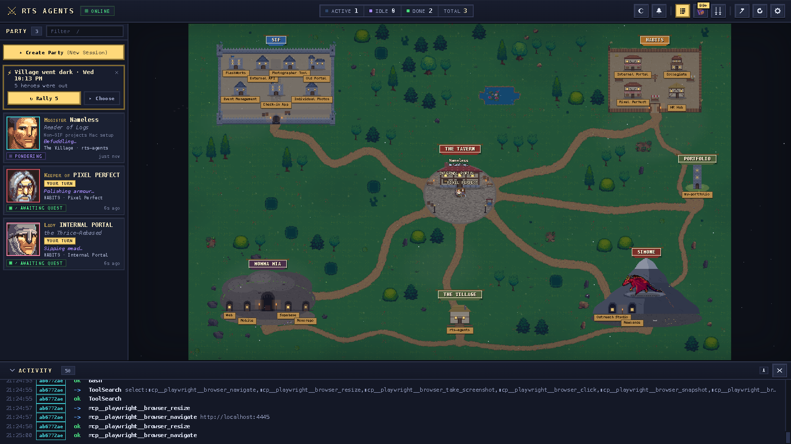
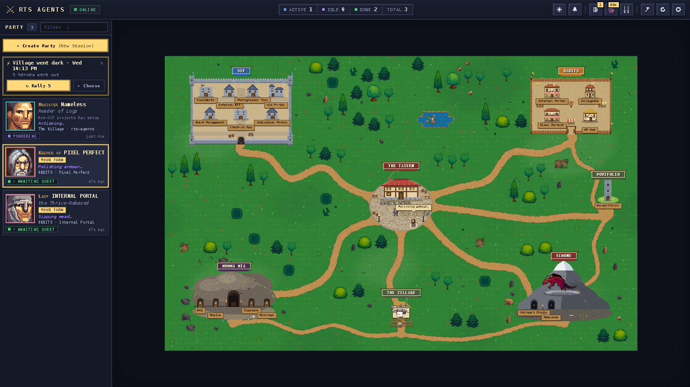
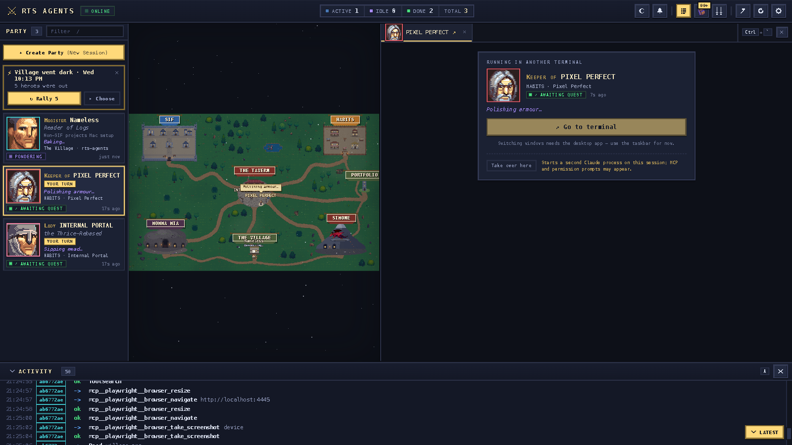
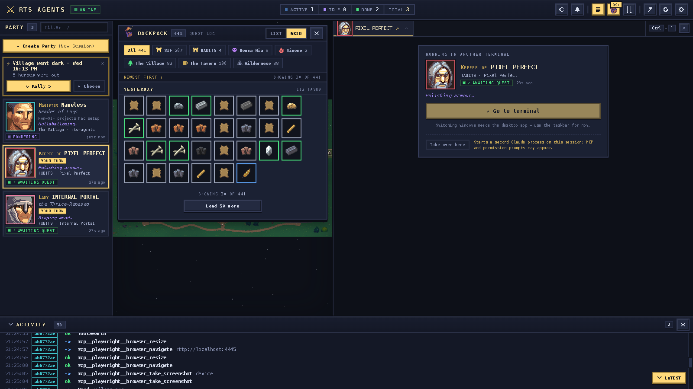

<div align="center">

# ⚔️ Claude Village

**Your Claude Code sessions, alive in a pixel-art fantasy world.**

Every running session is a hero. Heroes rest at the tavern, march out to the city, dungeon or dragon lair of the project they're working in, and swing a hammer, read a scroll or brew a potion depending on the tool they're using, all live.




[Quick start](#-quick-start) · [The world](#the-world) · [Rewards](#rewards-backpack--journal) · [Desktop app](#desktop-app) · [Credits](#credits)

</div>

---

## ✨ Highlights

<table>
<tr>
<td width="50%" valign="top">

**🗺️ A living map**<br>
Sessions are read straight from the logs Claude Code already writes. No plugin, no wrapper, no config. Start `claude` anywhere and a hero walks out of the tavern.

**🖥️ Real terminals, one click away**<br>
Click a hero and the desktop app opens its actual `claude --resume` terminal beside the map. Fork it as a Squire, or start a new quest in any project.

</td>
<td width="50%" valign="top">

**🎒 Loot for finished turns**<br>
Every completed turn drops a crafting material, rarity-weighted by the tool used. The backpack and journal double as a "where did we leave off" log per project.

**⚡ Survives a power cut**<br>
A crash-safe roster remembers who was out. After a reboot, **Rally** brings every session back, each in its own tab.

</td>
</tr>
</table>

<table>
<tr>
<td width="50%"><br><sub><b>Day mode.</b> Cities, dungeon, dragon lair and landmarks, linked by auto-routed roads.</sub></td>
<td width="50%"><br><sub><b>Hero drawer.</b> Select a hero to open its session, then jump to its terminal or take it over.</sub></td>
</tr>
<tr>
<td width="50%"><br><sub><b>Backpack.</b> Every finished turn earns an item, filterable by project.</sub></td>
<td width="50%" valign="middle">

> *The dragon on Simone's mountain gets bored. Put a hero to work in the lair and it lands to be petted.*

Inspired by [Agent Quest](https://github.com/FulAppiOS/Agent-Quest).

</td>
</tr>
</table>

---

## How it works

A real-time, gamified command centre for your local [Claude Code](https://claude.com/claude-code) CLI sessions. Every running session becomes a pixel-art hero in a fantasy world: heroes rest at the **Tavern** in the middle and walk out along winding roads to the **city, dungeon or lair of the project they're working in**, where they hammer, read scrolls, spar or brew potions depending on the tool in use — all live, by tailing the session logs Claude Code already writes to `~/.claude*`. Select a hero and the **desktop app** opens its real Claude Code terminal next to the map.

## Requirements

- **Bun ≥ 1.1** — [bun.sh](https://bun.sh) (`curl -fsSL https://bun.sh/install | bash`)
- **Claude Code** installed and used at least once (so `~/.claude/projects/` exists)
- Windows (native, tested — run Bun as `bun.cmd` from Git Bash), macOS or Linux.
- For the desktop app: Node ≥ 20 + npm (Electron and node-pty are installed with npm, see below).

## 🚀 Quick start

```sh
git clone https://github.com/kitdaniellim/claude-village.git && cd claude-village
bun install
bun start
```

Then open **http://localhost:4445**. The server listens on **http://localhost:4444**.

Start a Claude Code session in any terminal and watch a hero walk out of the tavern.

## The world

The **Tavern** sits in the centre — heroes that are idle, finished (waiting for you) or working from the bare coding root gather there. Everything around it is a **project**, resolved from each session's `cwd` by `client/src/world/registry.ts`:

| Place | Kind | Buildings (one per repo) |
| --- | --- | --- |
| 🏰 **SIF** | walled stone city | FlashWorks · External API · Photographer Tool · Old Portal · Event Management · Check-in App · Individual Photos |
| 🏘️ **HABITS** | timber market town | Internal Portal · Collegiate · Pixel Perfect · HR Hub (Lovable sessions have no local cwd, so they're placed by title keywords) |
| 🕳️ **Momma Mia** | dungeon | Web · Mobile · Supabase · Monorepo (doors in the cave) |
| 🐉 **Simone** | dragon lair | Outreach Studio · Newsance — a hero working here wards off the dragon |
| 🗼 **Portfolio**, 🏡 **The Village** (this repo) | wild landmarks | one each |
| ✨ anything new | wild landmark | auto-discovered the first time a session runs in an unknown folder ("Discovered!"), remembered in `localStorage` |

Edit `PLACES` in the registry to add a city or rename a building.

## Tool → action

A working hero walks to its repo's building and performs an action for the tool category:

| Category | Tools | Action |
| --- | --- | --- |
| 📚 library | `Read` `Glob` `LS` `Grep` | reads a scroll |
| 🔨 forge | `Edit` `Write` `MultiEdit` | hammers, with sparks |
| ⚔️ arena | `Bash` `PowerShell` `Execute` | sword drills |
| 🏰 castle | `Task` `Agent` `Workflow` | raises a banner |
| 🗼 watchtower | `TodoRead` `TodoWrite` plan mode | spyglass |
| ⛪ chapel | `WebSearch` `WebFetch` | kneels, glowing |
| ⚗️ alchemist | anything else (MCP tools, …) | stirs a cauldron |

Markers: `!` on error · `z z z` idle · sparkle when a turn finishes · ring on the selected hero. The party card shows the session's `/rename` name first, then its id and place, then a flavour line ("Hammering code…").

## Terminal drawer, sound, shortcuts

- **Click a hero or party card** → the right-hand drawer opens straight on that session's terminal. In the desktop app it is a real `claude --resume <id>` terminal (xterm.js + node-pty) in the session's folder, with **⚔ Fetch Squire** (forks the session with its context as a new hero named "Squire of <hero>") and **New session here** (a fresh `claude --name Nameless`); in a browser tab it shows the commands to copy instead.
- **Click a city or building** → "Start a quest" chooser for that project's repos.
- **Every running Claude Code process is a hero**, however quiet: the server reads `~/.claude/sessions/<pid>.json` (pid, `/rename` name, Claude's own busy/idle status) so heroes only leave when the process exits. Heroes are called by their `/rename` name, or **Nameless** until they get one (the AI's own title shows underneath). A session that's already open in another terminal still opens, under an amber "also open in another terminal" strip — prefer prompting it there.
- **Move into the village**: in the desktop app, **⇲ Move N terminals into the village** (under Create Party) takes over every Claude Code session running in an outside terminal. After a confirm, each outside `claude` process is closed and the same session resumes in a village tab. A session mid-turn is never interrupted: it waits and moves the moment its turn ends. The outside terminal is left at its shell prompt. Before closing anything, the app checks that the pid really is `claude` and that its session file names that session.
- **Rally after a power cut**: the server keeps a crash-safe roster of running sessions in `~/.rts-agents/rally.json`. After a brownout or reboot, a "Village went dark" card in the party bar lists the heroes that were out; **Rally** resumes them all, each in its own drawer tab, one after another. With no outage it offers sessions closed in the last 3 hours. **Choose** picks which ones; × dismisses them.
- **Sound cues** (8-bit, synthesised): a fanfare when a session finishes a turn and needs you, a chime for the selected one, a buzz on errors, a blip for new sessions, a jingle for rewards. 🔔 in the top bar mutes.
- **Activity dock** at the bottom: collapse it to a one-line ticker with an unread badge, or close it; restore from the top bar.
- Shortcuts: `` Ctrl+` `` toggle drawer · `A` activity dock · `B` backpack · `J` journal · `M` mute · `Esc` close · `/` filter the party. Wheel zooms the map, drag pans, double-click a hero centres on it.

## Rewards: backpack & journal

Every finished turn (a `turn_done` in the log, at most one per session per 15 s) earns the hero a **crafting material** — rarity-weighted (common/uncommon/rare/epic) and biased toward the tool it was using (forge turns yield ores, library turns scrolls, arena turns beast parts…). A toast shows the drop; the **backpack** (top-right, `B`) lists the inventory per project with rarity frames and lore tooltips.

The **journal** (`J`) is the "where did we leave off" log: per project, newest first, each line = time · session name · the turn's closing summary · item earned. Click a session to select it, or a project header to start a quest there. State persists in `~/.rts-agents/rewards.json` (server-side, so the browser tab and the desktop app agree).

## Configuration

| Variable | Where | Default | Effect |
| --- | --- | --- | --- |
| `PORT` | `server/.env` | `4444` | HTTP + WebSocket server port |
| `CLIENT_URL` | `server/.env` | `http://localhost:4445` | Origin allowed by CORS |
| `RTS_LAN` | env | _(unset)_ | `1` binds `0.0.0.0` on both server & client and prints LAN URLs, so you can watch the village from another device |
| `VITE_SERVER_URL` | `client/.env` | `http://<hostname>:4444` | Point the dashboard at a non-default server |

Copy `server/.env.example` → `server/.env` (and the client one) to customise.

## Map editor

Click the ⚒ **editor** button in the top bar to enter editor mode: drag whole places (cities, the dungeon, the lair, landmarks) around the tile grid; roads re-route themselves. The layout persists in `localStorage` (`rts-agents.layout.v2`); **Reset layout** restores the defaults.

## Troubleshooting

**`bun: command not found`** — install Bun (`curl -fsSL https://bun.sh/install | bash`), then restart your shell. On Windows without WSL2: `npm install -g bun` also works.

**`port 4444 (or 4445) already in use`** — something else is bound there. Either stop it, or set `PORT` in `server/.env` (and `VITE_SERVER_URL` in `client/.env` to match). The client port lives in `client/vite.config.ts` (`strictPort` is on, so Vite fails fast instead of silently shifting ports).

**Empty village / "No ~/.claude installation detected"** — the server found no `~/.claude*` directory containing a `projects/` folder. Install Claude Code and run it once. If your install lives somewhere exotic, symlink it to `~/.claude`.

**Village is quiet (no heroes)** — only sessions with log activity in the last 30 minutes appear, and heroes retire from the village after 30 minutes of silence. Start (or type into) a Claude Code session and it will appear within a couple of seconds.

**"Server offline — retrying…" banner** — the dashboard lost its WebSocket. It reconnects automatically with exponential back-off (max 30s); check that `bun run dev:server` is still alive.

## Desktop app

An Electron shell (tray icon, **Launch on startup** toggle in ⚙ Settings, embedded Claude Code terminals via
node-pty) lives in [`desktop/`](./desktop/README.md). It is a separate npm
package, not a bun workspace:

```sh
bun run desktop:install   # once — downloads Electron
bun run desktop           # starts the server/client if needed, opens the window
bun run desktop:smoke     # headless self-test: SMOKE OK <claude version>
```

### One-click launch

| | Install once | Then |
|---|---|---|
| **macOS** | `bun run launcher:mac` → `~/Applications/claude-village.app` | ⌘Space → *claude-village*, or drag it to the Dock. Double-clicking `claude-village.command` in Finder also works. |
| **Windows** | `bun run launcher:win` → Desktop + Start-menu shortcuts | Start → *claude-village* (right-click → Pin to taskbar), or double-click `claude-village.cmd`. |

Both launchers install missing dependencies on first run. On macOS the app logs to
`~/.rts-agents/desktop.log`, and **Launch on startup** writes a LaunchAgent at
`~/Library/LaunchAgents/dev.rts-agents.desktop.plist`. If you move the repo, run the install
command again.

## Party Leader (command center)

One session named **PARTY LEADER** oversees all your other Claude Code sessions.

- **👑 Recruit Party Leader** (under Create Party) starts it.
- **👑 Review** in any party's drawer bar opts that party in: whenever it finishes a turn, the
  village types `/party-leader review {…}` into the Leader, which checks the work and either
  approves, messages the worker with fixes (they iterate until approved), or flags you.
  Verdicts show on the party card (hover for the note) and live in `~/.rts-agents/reviews.json`.
- Talk to the Leader directly for status, "tell X to …", "check on X", or a daily round-up.

The Leader's playbook is the `party-leader` skill. Install it once per machine:

```sh
mkdir -p ~/.claude/skills && cp -R claude-skills/party-leader ~/.claude/skills/
```

The Leader and its workers must run in the same permission mode (cross-session messages
between different modes wait for your approval), and the Leader must run inside the village
to receive reviews.

## Development

```sh
bun run dev:server   # server only (bun --watch)
bun run dev:client   # client only (vite)
bun run typecheck    # strict tsc over both workspaces
```

The wire protocol and module contracts are documented in [`PROTOCOL.md`](./PROTOCOL.md).
A global launcher lives at `bin/rts-agents` — symlink it onto your `PATH`:

```sh
ln -s "$(pwd)/bin/rts-agents" /usr/local/bin/rts-agents
```

## Credits

Third-party art lives under `client/public/assets/<pack>/`, each folder with its own `LICENSE.txt`.

| Asset | Author | License | Source |
| --- | --- | --- | --- |
| Lair dragon (`assets/dragon/reddragonfly3.png`) — "Red Dragon" flying sprite, fetched 2026-10-14 | [ZaPaper](https://opengameart.org/users/zapaper) · credits to [Buko Studios](http://www.buko-studios.com/), commissioned by [PlayCraft](https://www.playcraftapp.com/) | [CC-BY 3.0](https://creativecommons.org/licenses/by/3.0/) | [opengameart.org/content/red-dragon-0](https://opengameart.org/content/red-dragon-0) |
| Error monsters (`assets/monsters/calciumtrice/{eyeball,goblin,orc}.png`) — "Forest Monsters", "Animated Goblins", "Animated Orcs", fetched 2026-10-15 | [Calciumtrice](https://opengameart.org/users/calciumtrice) | [CC-BY 3.0](https://creativecommons.org/licenses/by/3.0/) | [forest-monsters](https://opengameart.org/content/forest-monsters) · [animated-goblins](https://opengameart.org/content/animated-goblins) · [animated-orcs](https://opengameart.org/content/animated-orcs) |
| Error monsters, goblin + ogre (`assets/monsters/user-preview/{goblin,ogre}.png`) — extracted from the user-supplied "Pixel Art Animated Ogre / Goblin Game Asset" marketplace preview images, 2026-10-15; Calciumtrice goblin/orc stay as fallback | original author unknown | unknown — personal use only; verify licence before distributing | user's Downloads (no source URL) |
| Hero swords (`assets/weapons/ocal-swords/32x32/*.png`) — "sword-ocal_20230219": long sword, medieval sword, gladius ×2, scimitar ×2, tanto, heavy sword, muramasa; user-supplied 2026-10-15 | [openclipart.org](https://openclipart.org) contributors | Public domain ([CC0 1.0](https://creativecommons.org/publicdomain/zero/1.0/)) | per-sword links in `assets/weapons/ocal-swords/LICENSE.txt` (e.g. [22181](https://openclipart.org/detail/22181)) |
| Playful Simone dragon (`assets/dragon/flying-rework/*.png`) — "Flying Dragon Rework" 1.1 (red, gold, twin-headed; 144x128 + 191x161), user-supplied 2026-10-15 | [ZaPaper](https://opengameart.org/users/zapaper) & Jordan Irwin ([AntumDeluge](https://opengameart.org/users/antumdeluge)) · credits to [Buko Studios](http://www.buko-studios.com/), commissioned by [PlayCraft](https://www.playcraftapp.com/) | [CC-BY 3.0](https://creativecommons.org/licenses/by/3.0/) | [opengameart.org/node/83655](https://opengameart.org/node/83655) |
| Petting hearts (`assets/icons/lemcraft/heart.png`) — "LemCraft", user-supplied 2026-10-15 | Matt Hackett of [Lost Decade Games](https://opengameart.org/users/richtaur) | [CC0 1.0](https://creativecommons.org/publicdomain/zero/1.0/) | [opengameart.org/content/lemcraft](https://opengameart.org/content/lemcraft) |
| Item icons (`assets/icons/crafting/nails.png`) — "RPG crafting material icons", fetched 2026-10-14 | BizmasterStudios | [CC-BY 4.0](https://creativecommons.org/licenses/by/4.0/) | [opengameart.org/content/rpg-crafting-material-icons](https://opengameart.org/content/rpg-crafting-material-icons) |
| Backpack bag (`assets/icons/inventory-24/pixel_icons_by_oceansdream.png`) — "Various inventory 24 pixel icon set", one 24 px cell drawn as a CSS sprite on the top-bar backpack button and the Backpack panel, fetched 2026-10-15 | [OceansDream](http://oceansdream.deviantart.com/art/Pixel-Icons-available-for-use-121152370) · submitted by qubodup | [CC-BY 3.0](https://creativecommons.org/licenses/by/3.0/) (also offered as CC-BY-SA 3.0) | [opengameart.org/content/various-inventory-24-pixel-icon-set](https://opengameart.org/content/various-inventory-24-pixel-icon-set) |
| Hero portraits (`assets/portraits/fantasy-32/portraits.png`) — "32x32 Fantasy portrait set", 13 faces drawn as CSS sprites on party cards / terminal tabs / journal chips, fetched 2026-10-14 | [CobraLad](https://opengameart.org/users/cobralad) | [CC-BY 3.0](https://creativecommons.org/licenses/by/3.0/) | [opengameart.org/content/32x32-fantasy-portrait-set](https://opengameart.org/content/32x32-fantasy-portrait-set) |
| Hero sprites (`assets/characters/lpc/png/`) — "[LPC] Medieval fantasy character sprites", layered 64 px sheets composited at runtime, fetched 2026-10-14 | [wulax](https://opengameart.org/users/wulax) (Johannes Sjölund) · base sprites by Stephen Challener (Redshrike) | [CC-BY-SA 3.0](https://creativecommons.org/licenses/by-sa/3.0/) / GPL 3.0 / OGA-BY 3.0 | [opengameart.org/content/lpc-medieval-fantasy-character-sprites](https://opengameart.org/content/lpc-medieval-fantasy-character-sprites) |
| Terrain, trees, props (`assets/tiles/lpc/terrain_atlas.png`) — "LPC Tile Atlas", 32 px tiles drawn at 0.5x, fetched 2026-10-14 | compiled by [adrix89](https://opengameart.org/users/adrix89) from Liberated Pixel Cup art by Lanea Zimmerman, Stephen Challener, Charles Sanchez, Manuel Riecke, Daniel Armstrong, Casper Nilsson, Daniel Eddeland, Johann Charlot, Skyler Robert Colladay | [CC-BY-SA 3.0](https://creativecommons.org/licenses/by-sa/3.0/) / GPL 3.0 | [opengameart.org/content/lpc-tile-atlas](https://opengameart.org/content/lpc-tile-atlas) |

Cities, the dungeon, the lair, the tavern and the UI icons are drawn programmatically in `client/src/world/`; the programmatic hero and terrain remain as fallbacks while the sheets load. The credit list is also exported from `client/src/utils/credits.ts` for the in-app About row.
